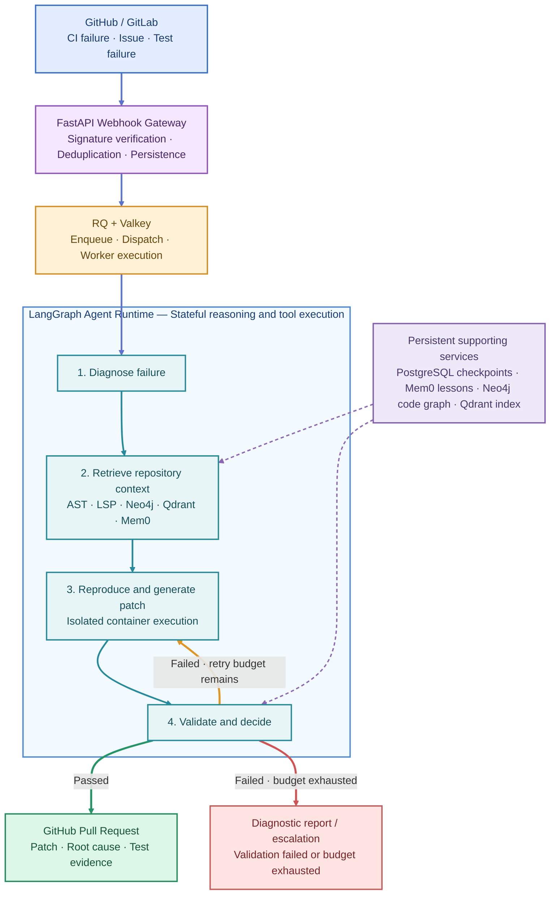
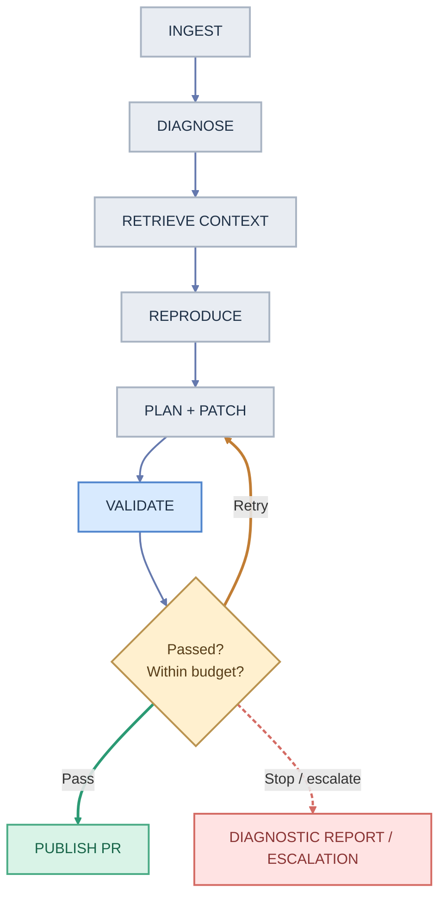

# Autonomous Self-Healing SWE Agent

*Development roadmap, system architecture, technology responsibilities, and Python project structure*

We'll design this as a **production-oriented, modular Python application** using your selected stack:

| LangGraph | Mem0 | RQ + Valkey |
|---|---|---|
| Agent orchestration | Persistent agent memory | Background jobs |
| Neo4j | Qdrant | PostgreSQL |
| Code relationships | Semantic retrieval | Checkpoints and records |

## 1. Technology ownership

Each technology should have a clearly defined responsibility. This is important because several of these systems can store overlapping types of data.

| Technology | Primary responsibility |
|---|---|
| **Python + FastAPI** | Webhooks, API endpoints, service coordination |
| **LangGraph** | Stateful agent workflow, conditional routing, retries |
| **Mem0** | Long-term memory of previous bugs, fixes, and lessons |
| **Redis Queue (RQ)** | Scheduling and executing background jobs |
| **Valkey** | Queue backend, short-lived coordination, job metadata |
| **Neo4j** | Code dependency and symbol relationship graph |
| **Qdrant** | Vector search across code, logs, and documentation |
| **PostgreSQL** | LangGraph checkpointing, run history, audit records |
| **Tree-sitter + LSP** | Structural parsing and precise code navigation |
| **Docker** | Isolated testing and patch execution |
| **GitHub API** | CI inspection, branch creation, commits, pull requests |

**Important architectural distinction:** RQ is the Python job queue and Valkey is its backing server. They are not two separate queueing frameworks. RQ supports Valkey directly.

Likewise, PostgreSQL should persist the agent's execution state, while Mem0 should store reusable knowledge learned across executions. LangGraph provides an official PostgreSQL checkpointer for durable workflows.

## 2. Proposed system architecture



The key design decision is that **LangGraph orchestrates the workflow, but independent Python services implement the actual operations**. This keeps parsing, retrieval, sandboxing, GitHub integration, and memory testable without requiring an LLM for every operation.

## 3. Recommended project structure

I recommend a modular monolith initially, with separately runnable API and worker processes. This is simpler than microservices while keeping strong separation between components.

```text
self-healing-swe-agent/
│
├── src/
│   └── swe_agent/
│       ├── main.py
│       ├── config.py
│       │
│       ├── api/
│       │   ├── routes/
│       │   │   ├── webhooks.py
│       │   │   ├── runs.py
│       │   │   └── health.py
│       │   ├── schemas/
│       │   └── dependencies.py
│       │
│       ├── agents/
│       │   ├── graph.py
│       │   ├── state.py
│       │   ├── routing.py
│       │   ├── nodes/
│       │   │   ├── ingest.py
│       │   │   ├── diagnose.py
│       │   │   ├── retrieve.py
│       │   │   ├── reproduce.py
│       │   │   ├── plan.py
│       │   │   ├── patch.py
│       │   │   ├── validate.py
│       │   │   ├── reflect.py
│       │   │   └── publish.py
│       │   └── prompts/
│       │
│       ├── tools/
│       │   ├── registry.py
│       │   ├── git_tools.py
│       │   ├── ast_tools.py
│       │   ├── search_tools.py
│       │   ├── sandbox_tools.py
│       │   └── test_tools.py
│       │
│       ├── integrations/
│       │   ├── github/
│       │   ├── gitlab/
│       │   └── mcp/
│       │
│       ├── intelligence/
│       │   ├── parser.py
│       │   ├── symbol_index.py
│       │   ├── graph_builder.py
│       │   ├── embeddings.py
│       │   └── retriever.py
│       │
│       ├── memory/
│       │   ├── mem0_service.py
│       │   └── memory_policy.py
│       │
│       ├── persistence/
│       │   ├── postgres.py
│       │   ├── checkpoints.py
│       │   ├── models.py
│       │   ├── neo4j.py
│       │   └── qdrant.py
│       │
│       ├── queue/
│       │   ├── connection.py
│       │   ├── jobs.py
│       │   └── worker.py
│       │
│       ├── sandbox/
│       │   ├── docker_manager.py
│       │   ├── executor.py
│       │   ├── policies.py
│       │   └── cleanup.py
│       │
│       ├── services/
│       │   ├── run_service.py
│       │   ├── repository_service.py
│       │   └── pull_request_service.py
│       │
│       └── observability/
│           ├── logging.py
│           └── metrics.py
│
├── tests/
│   ├── unit/
│   ├── integration/
│   ├── agent/
│   ├── security/
│   └── fixtures/
│       └── broken_repositories/
│
├── scripts/
│   ├── setup_databases.py
│   └── index_repository.py
│
├── infra/
│   ├── docker/
│   └── compose.yaml
│
├── migrations/
├── docs/
│   ├── architecture.md
│   ├── agent-workflow.md
│   └── security-model.md
│
├── .github/workflows/
├── .env.example
├── pyproject.toml
├── uv.lock
├── Dockerfile
└── README.md
```

### Essential architecture rules

- `agents/` owns reasoning and graph transitions, not direct infrastructure implementations.
- `tools/` provides narrow, validated operations callable by the agent.
- `intelligence/` performs repository analysis and indexing.
- `persistence/` owns database access, distinct from business logic.
- `sandbox/` enforces execution limits and isolation.
- `queue/` handles job delivery; PostgreSQL holds authoritative run status.

This structure also makes it easier to replace individual technologies later.

## 4. Agent state machine

The central LangGraph should operate as a deterministic workflow with conditional transitions.



*Conceptual graph: unsuccessful validation loops back into patching until the retry budget is exhausted. Exhausted or unreproducible runs become diagnostic reports rather than unverified fixes.*

A minimal state model might look like this:

```python
from typing import TypedDict, Literal

class AgentState(TypedDict):
    run_id: str
    repository: str
    commit_sha: str
    failure_logs: str
    suspected_files: list[str]
    root_cause: str | None
    patch_diff: str | None
    reproduction_confirmed: bool
    test_results: dict
    attempt: int
    max_attempts: int
    status: Literal[
        "pending",
        "diagnosing",
        "patching",
        "validating",
        "passed",
        "failed",
    ]
```

The complete implementation should use structured artifacts, failure classifications and immutable execution metadata, rather than just concatenating messages or storing raw logs in the graph state.

## 5. Development roadmap

### 01 — Foundation and infrastructure

**Week 1**

**Goal:** Running API, database services, webhook verification, and RQ worker

- Set up Python project with uv and Ruff
- Create Docker Compose for PostgreSQL, Valkey, Neo4j and Qdrant
- Implement GitHub webhook authentication and delivery deduplication
- Persist incoming events and enqueue background work

### 02 — LangGraph and checkpoints

**Week 2**

**Goal:** Resumable agent workflow with mock diagnosis and validation tools

- Define graph state and transitions
- Integrate AsyncPostgresSaver
- Add attempt limits, budgets and terminal failure states
- Test worker restart and graph resumption

### 03 — Repository intelligence

**Weeks 3–4**

**Goal:** Agent can discover relevant code for a failure

- Clone pinned repository commits
- Implement Tree-sitter symbol extraction
- Index relationships in Neo4j
- Build code embeddings in Qdrant and hybrid retrieval

### 04 — Sandbox and reproduction

**Weeks 5–6**

**Goal:** Reproduce a failing test and capture reliable evidence

- Build isolated execution manager
- Install dependencies from trusted lockfiles
- Run target tests with timeout and resource limits
- Collect logs, exit codes and test reports

### 05 — Patching and self-correction

**Weeks 7–8**

**Goal:** Produce and validate patches automatically

- Implement structured patch generation
- Apply and validate diffs
- Run focused and broader regression tests
- Feed validation results into bounded repair attempts

### 06 — Memory and autonomous PRs

**Weeks 9–10**

**Goal:** Reuse useful repair knowledge and submit reviewed changes

- Store verified repair lessons through Mem0
- Retrieve previous solutions scoped by repository
- Generate annotated pull requests
- Add human approval, audit logs and evaluation metrics

*Indicative 10-week solo-development plan. Scope, familiarity with LangGraph, and infrastructure constraints may change the timeline.*

## 6. Storage and memory strategy

I would keep four storage boundaries:

| Store | What to save | Scope |
|---|---|---|
| PostgreSQL | Checkpoints, runs, attempts, webhook deliveries, PR status | Transactional source of truth |
| Neo4j | Symbols, imports, call relationships, file dependencies | Repository + commit SHA |
| Qdrant | Code chunks, documentation, diagnostic log embeddings | Repository + indexed revision |
| Mem0 | Verified repair patterns, recurring causes, successful strategies | Repository/organization memory |

Mem0 should not automatically remember every model-generated fix. Save a repair lesson only after validation and attach evidence, repository scope, and code version. That reduces the risk of propagating incorrect fixes.

For LangGraph, use `AsyncPostgresSaver`; its setup routine creates the checkpoint schema and must be run when initializing the database.

## 7. Security and reliability requirements

Because this project executes code from external repositories, sandbox security is one of its most important engineering challenges.

I recommend implementing these protections before enabling autonomous repair on untrusted repositories:

- Run repository code in disposable, strongly isolated sandboxes, with restricted network access and no host Docker socket.
- Use a non-root identity, resource quotas, execution timeouts and process limits.
- Never pass GitHub credentials, LLM API keys, or database secrets into the execution sandbox.
- Limit writable files, patch size, retries, token usage and total execution duration.
- Require a human to approve pull requests before merging; never enable autonomous production deployment in the MVP.
- Use idempotent queue jobs and run-specific locks to prevent duplicate webhook events from starting conflicting repairs.
- Pin each repair to a commit SHA and reject or rebase stale changes before publishing.

Docker is suitable for a controlled prototype, but Docker alone is not a sufficient security boundary for running arbitrary hostile code. Stronger container isolation or microVMs should be considered before supporting public, untrusted repositories.

## 8. MVP acceptance criteria

Before adding advanced multi-agent planning, define a measurable first success.

**First end-to-end milestone**

*Implementation checklist*

- [ ] GitHub Actions failure triggers an authenticated webhook
- [ ] RQ worker starts exactly one logical repair run
- [ ] LangGraph restores progress from PostgreSQL after interruption
- [ ] Agent locates the faulty function in a Python repository
- [ ] Sandbox reproduces the original failing unit test
- [ ] Agent patches the bug within three attempts
- [ ] Relevant regression tests pass in a fresh sandbox
- [ ] Agent creates a pull request with root-cause and test evidence

**My proposed first implementation target:** an intentionally broken Python repository with one failing pytest case. The agent should receive a failure event, identify and correct the defect, verify the tests and prepare a pull request without human-written patches.

Once this works, the system has demonstrated the central autonomous repair loop. Neo4j, Qdrant and Mem0 can then be evaluated for how much they actually improve repair success, context retrieval and cost.

The next concrete step is to implement **Phase 1: Python project bootstrap, Docker Compose infrastructure, FastAPI webhook gateway and RQ/Valkey worker**, with PostgreSQL configured for checkpointing from the beginning.
